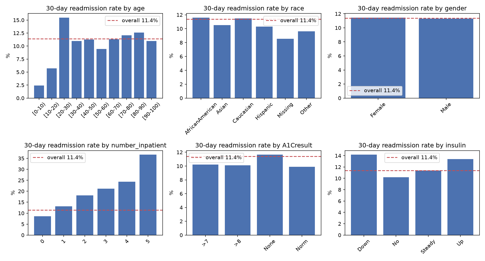
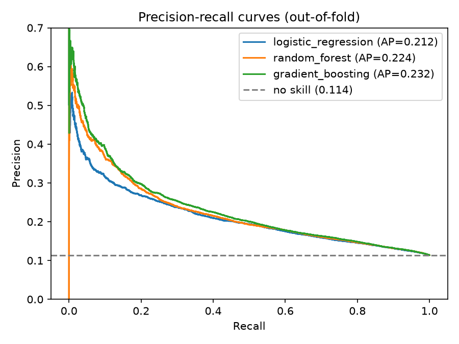
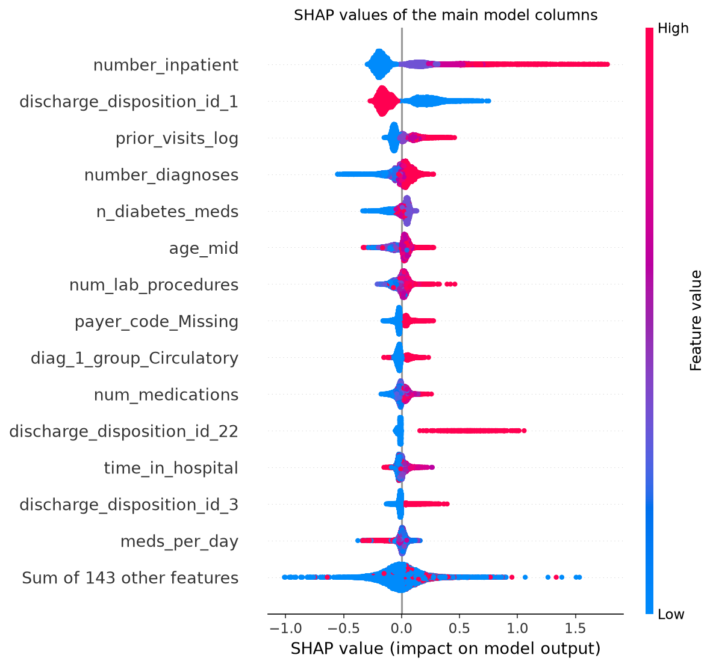
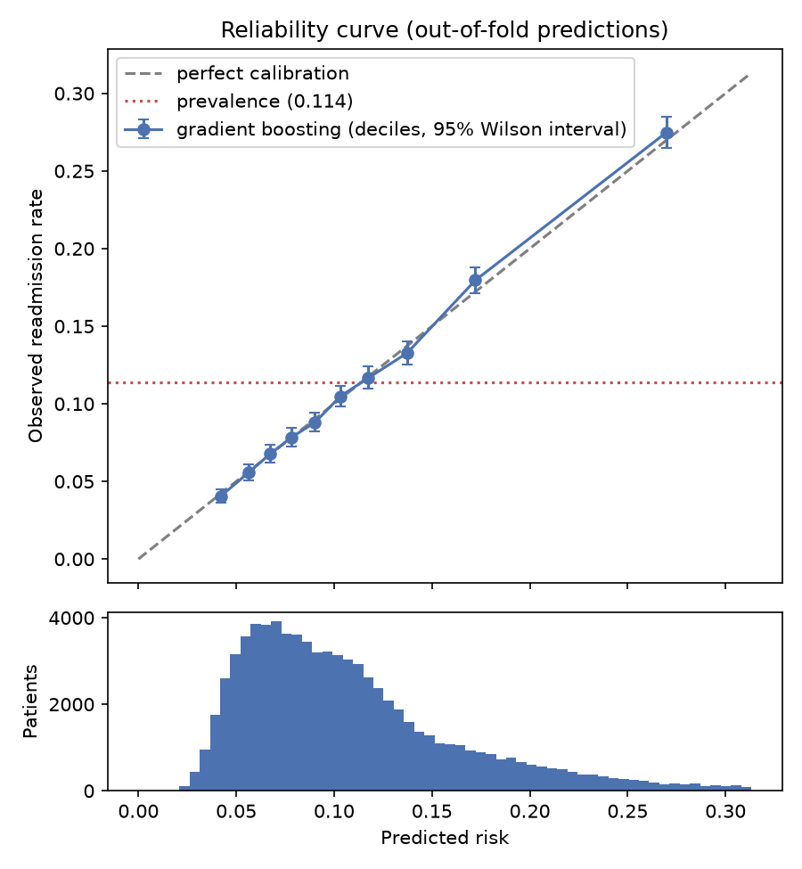
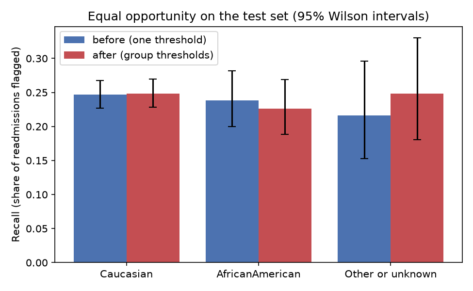

# Group Project: Predicting 30-Day Hospital Readmission in Diabetic Patients
19/11/2026 / **Maïane Benech, Carla LeFeuvre, Charlotte Delphina Rupp, Yasmine Regaieg** / *diabetes-readmission-ml*

- **Dataset:** Diabetes 130-US Hospitals (1999–2008), OpenML ID 4541 (101,766 encounters, 50 columns).
- **Task:** Binary classification: readmitted within 30 days (`<30`) vs. not (`>30` or `NO`).


## Setup

```bash
python -m venv .venv
source .venv/bin/activate
pip install -r requirements.txt
```

The raw data is to be found in `data/diabetes_130_raw.csv`. To redownload it from OpenML:

```bash
python download_data.py
```

## How to run

Each step is a standalone script. Run them in order from the project root:

```bash
python step1_eda_framing.py
python step2_feature_engineering.py
python step3_class_imbalance.py
python step4_model_comparison.py
python step5_pipeline.py
python step6_tuning.py
python step7_run_log.py
python step8_explainability.py
python step9_calibration.py
python step10_fairness.py
```


## Overview

| Step | Script | What it does |
|---|---|---|
| 1 | `step1_eda_framing.py` | Data quality, target framing (death/hospice discharges removed), leakage audit, patient-grouped train/test split, no-skill baselines |
| 2 | `step2_feature_engineering.py` | Drops IDs and unusable columns, engineers 9 features (age midpoint, ICD-9 diagnosis groups, prior visits, medication counts and changes, medications per day), imputation, scaling and one-hot encoding |
| 3 | `step3_class_imbalance.py` | Compares no remedy, class weights, undersampling and SMOTE; cost-based threshold (missed readmission = 10× false alarm); top 10% / 20% alert volumes |
| 4 | `step4_model_comparison.py` | Logistic regression → random forest → gradient boosting, same metrics for all three, train vs. validation gap |
| 5 | `step5_pipeline.py` | One scikit-learn `Pipeline` per model (features → preprocessing → model), leakage check, robustness to unseen categories, saved models |
| 6 | `step6_tuning.py` | Optuna (TPE, 20 trials per model), 5-fold patient-grouped CV per trial, test set untouched |
| 7 | `step7_run_log.py` | Run log of every tuning trial with its parameters, metrics and linked artifacts |
| 8 | `step8_explainability.py` | SHAP global importance, effect directions and local explanations of individual patients |
| 9 | `step9_calibration.py` | Reliability curve, Brier score, ECE, calibration slope, recalibration comparison |
| 10 | `step10_fairness.py` | Fairness audit by race on the untouched test set, mitigation with group-specific thresholds, before/after comparison |

## Evaluation Design

- **Split:** 80% development / 20% test with `StratifiedGroupKFold` grouped by `patient_nbr`, so no patient appears in both sets.
- **Validation:** 5-fold grouped, stratified cross-validation inside the development set.
- **Test set:** used only once, in step 10.
- **Main metric:** average precision (PR-AUC), because the positive class is only about 11%. ROC-AUC, Brier score, recall at a fixed alert volume and cost are also reported.

## Project Layout

```
├── common.py                  # shared paths, seed, data loading, CV splitter
├── download_data.py           # downloads the dataset from OpenML
├── step1_ … step10_*.py       # one script per technical requirement
├── data/                      # raw CSV
├── models/                    # saved pipelines (.joblib), regenerated by steps 5 and 6
├── reports/
│   ├── figures/               # all plots, prefixed by step
│   ├── tables/                # all result tables (CSV), prefixed by step
│   └── run_log.csv            # every tuning trial (step 7)
├── run_all.log                # console output of the last full run
├── PROBLEM.md                 # problem statement and research question
└── requirements.txt
```

## Model is Saved

Each saved file contains preprocessing and the model together, so it takes raw rows as input:

```python
import joblib
from common import load_dataset, TARGET

model = joblib.load("models/step6_gradient_boosting_best.joblib")
patients = load_dataset().drop(columns=TARGET).head(5)
print(model.predict_proba(patients)[:, 1])  # 30-day readmission risk
```

## Commit History

This is the commit history of our project so far:

```python
b673808 (HEAD -> main, origin/main, origin/HEAD) Add step 9 (calibration) and step 10 (fairness) (Yasmine Regaieg, 2026-11-18)
3c7f44e Merge branch 'feat/charlotte-step8' (Charlotte-Delphina Rupp, 2026-11-17)
03837cb (feat/charlotte-step8) feat: add step 8 (Charlotte-Delphina Rupp, 2026-11-17)
c49d85a (origin/charlotte-step7, charlotte-step7) feat: add step 7 (Charlotte-Delphina Rupp, 2026-11-17)
e891915 feat: hyperparameters tuning (Carla LeFeuvre, 2026-11-17)
a6ce2e5 feat : pipeline check (Carla LeFeuvre, 2026-11-17)
088c512 Add pipeline run log (Charlotte-Delphina Rupp, 2026-11-16)
a374bd6 Merge pull request #1 from maianebnc-hash/charlotte-modifications (charlottedelphinar, 2026-11-16)
3bdc7a6 fix: headers (Charlotte-Delphina Rupp, 2026-11-16)
8101767 Step 4: Model comparison (maianebnc-hash, 2026-11-15)
20994eb Step 4: model comparison (maianebnc-hash, 2026-11-15)
0195f70 Merge GitHub changes with local project (maianebnc-hash, 2026-11-14)
9047412 Add context, problem statement and research question (maianebnc-hash, 2026-11-14)
0421bf9 Update step2_feature_engineering.py (maianebnc-hash, 2026-11-14)
b1bda20 Update step1_eda_framing.py (maianebnc-hash, 2026-11-14)
1484f9d step3 (maianebnc-hash, 2026-11-14)
43a3ee0 first commit (maianebnc-hash, 2026-11-14)
8aeff9d Step 2: feature engineering and preprocessing (Maiane Benech, 2026-11-14)
1a59773 Step 1: EDA and problem framing (Maiane Benech, 2026-11-14)
7eed7cd Add the raw Diabetes 130-US Hospitals dataset as CSV (Maiane Benech, 2026-11-14)
```


# Our Problem more in Detail

Hospital readmissions **increase costs**, add to **hospital overcrowding** and often reflect **preventable complications**. Patients with diabetes are especially at risk because of their **complex conditions, treatments and hospitalization histories**. 
Identifying high-risk patients before discharge lets care takers prioritize follow-ups and preventive interventions.

## Our Research question

> **Can we predict whether a diabetic patient will be readmitted within 30 days of discharge from their demographics, medical history, clinical measurements and treatments?**

## Dataset

About 101,766 encounters from 130 US hospitals (1999–2008), covering:

- **Demographics:** age, gender, race
- **Hospitalization:** length of stay, admission type, discharge disposition
- **Medical history:** previous inpatient, outpatient and emergency visits, diagnoses
- **Clinical measurements:** lab tests, HbA1c results
- **Treatments:** insulin, diabetes medications, medication changes

## Target

The raw `readmitted` column has three values: `<30`, `>30` and `NO`. We frame it as:

- **1:** readmitted within 30 days (`<30`)
- **0:** not readmitted within 30 days (`>30` or `NO`)

Encounters ending in death or hospice (2,423 rows) are removed, because those patients cannot be readmitted, as are 3 rows with an invalid gender. About 11% of the remaining 99,340 encounters are positive.

## Objective and expected impact

Build an interpretable and reliable model that:

- flags high-risk patients before discharge,
- helps prioritize follow-up appointments and allocate limited resources,
- shows which factors are most associated with early readmission.

**Important:** Real clinical use would require further validation.

# Key results

|  | Result |
|---|---|
| **Final model** | Tuned gradient boosting |
| **Test average precision** | 0.232 (cross-validation: 0.233; no-skill: 0.114) |
| **Test ROC-AUC** | 0.670 |
| **Flagging the top 10% of patients** | catches 24% of readmissions, 2.4× better than random |
| **Calibration** | ECE 0.002, Brier 0.096 |

### Readmission rate by feature
Past inpatient stays are the strongest signal: patients with 5 or more prior stays are readmitted at 3 times the overall rate.



### Model comparison
Each model improves average precision a little. Gradient boosting ranks best, but the gains are close to the variation between folds.



### What drives the predictions (SHAP)
Prior inpatient stays and discharge destination carry 38% of the importance. Race and gender rank 27th and 23rd.



### Calibration
Predicted risks match observed readmission rates in all 10 deciles, so the probabilities can be used as is.



### Fairness audit
Group-specific thresholds reduce the recall gap between race groups from 3.1 to 2.2 points on the test set. The confidence intervals overlap, so the original gap may be noise.




